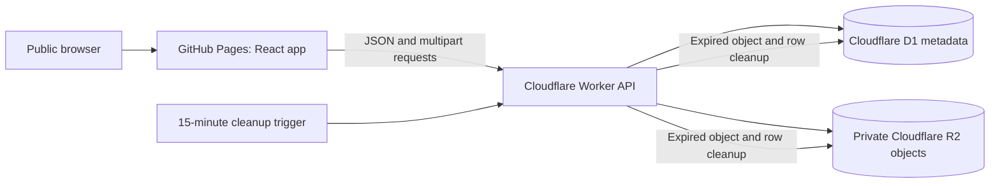

# Architecture

## Request path

GitHub Pages serves only the compiled interface. It does not host the API or receive uploaded file bytes. The browser sends file uploads to the Worker. The Worker is the only application component that uses D1 and R2 bindings.

## Frontend

- `src/App.tsx` contains the Upload and View tabs, client-side checks, upload request, metadata list, countdown, and download links.
- `src/styles.css` contains the responsive interface styles.
- `vite.config.ts` sets the project-site base path to `/PASTEBOX/`.
- The frontend receives `VITE_API_URL` at build time. Vite embeds this value in the public JavaScript bundle, so it must be a URL only, never a credential.
- If `VITE_API_URL` is unset, the UI displays a backend-not-connected message. The site is still useful for reviewing the interface, but uploads do not persist.

## Worker API

`worker/src/index.ts` handles all application data operations:

- Parses multipart form uploads and validates required fields.
- Enforces the 25 MiB file limit and rejects empty files.
- Creates random UUID identifiers and opaque object keys.
- Writes file bytes to R2 and metadata to D1.
- Lists only records whose expiry timestamp is later than the server's current time.
- Verifies the same expiry condition before a download and serves data as `application/octet-stream` attachments.
- Adds CORS headers for the configured Pages origin and local development.
- Removes expired objects and rows from a 15-minute scheduled task. A list request also starts best-effort cleanup.

R2 object keys are generated server-side and are not exposed in list responses. The bucket must remain private; do not enable public bucket access or a public custom domain for file objects.

## Data model

The `files` table is defined in `worker/migrations/0001_create_files.sql`:

| Column | Meaning |
|---|---|
| `id` | Random UUID exposed as the app's file identifier |
| `object_key` | Private R2 object key; unique per file |
| `original_name` | Sanitized upload filename, limited to 180 characters |
| `uploader_name` | Self-entered name (not verified) |
| `purpose` | Self-entered explanation |
| `size_bytes` | File length in bytes |
| `uploaded_at` | Server timestamp in ISO 8601 UTC |
| `expires_at` | `uploaded_at` plus six hours, in ISO 8601 UTC |

The application stores user-supplied name and purpose text as metadata. It does not store uploader accounts, email addresses, IP addresses, or authentication records. Cloudflare may separately process operational request logs under its own service terms and settings.

## Expiry behavior

Expiry has two parts:

1. **Access expiry:** synchronous checks in list and download endpoints make a file disappear and deny downloads at `expires_at`, even if cleanup has not run yet.
2. **Physical cleanup:** the Cron Trigger runs every 15 minutes and removes expired R2 objects and D1 rows in batches of up to 100. A failed cleanup is retried by a later scheduled run as long as the record remains; storage errors can delay physical removal.

The six-hour period begins when the Worker accepts the upload and records `uploaded_at`. The scheduled process may remove bytes later than the expiry instant; the API will already deny access.

## Trust boundaries

- The browser and all submitted fields/files are untrusted.
- The public API is callable by anyone, including scripts outside a browser.
- CORS limits which web pages can read API responses in a browser; it does not block direct HTTP clients and is not access control.
- D1 and R2 credentials are not sent to the browser. The Worker receives resource bindings from Cloudflare.
- A public Git repository contains source code and placeholder configuration only, never runtime secrets or user files.
