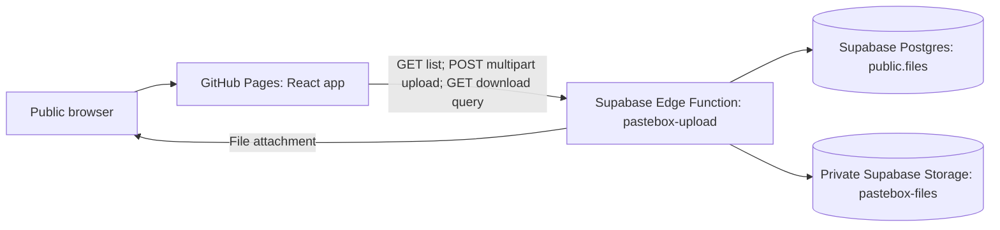

# Architecture

## Request path

GitHub Pages serves the compiled interface only. It does not store uploaded files. The browser calls the public Edge Function endpoint; the function performs privileged database and Storage operations server-side. The browser must never receive a service-role key.

## Frontend

- `src/App.tsx` contains the Upload and View tabs, input checks, upload request, metadata list, countdown, and download links.
- `src/styles.css` contains responsive interface styles.
- `vite.config.ts` sets the project-site base path to `/PASTEBOX/`.
- `VITE_API_URL` is injected at build time and embedded in the public JavaScript. It must contain only the function URL, never a credential.
- If `VITE_API_URL` is unset, the interface displays a storage-not-connected state.

## Supabase Edge Function

The deployed function is named `pastebox-upload`. Its current contract is:

- `GET /`: return active file metadata.
- `POST /`: accept multipart fields `file`, `name`, and `purpose`; validate and store the object and metadata.
- `GET /?download=<id>`: check expiry and return the file as a download.
- Expired records must be excluded from listings and downloads rejected.
- CORS must allow the public Pages origin and local development as needed.

The function source is currently maintained in the Supabase dashboard and is not checked into this repository. This makes reproducible deployment and review harder; preserve the exact deployed source in a repository-controlled location before future edits. Do not place secret values in that source.

## Data model

The Postgres table `public.files` currently contains:

| Column | Meaning |
|---|---|
| `id` | Random UUID exposed as the app's file identifier |
| `storage_path` | Unique path of the object in the private Storage bucket |
| `original_name` | Original filename, limited to 255 characters |
| `file_size` | File length in bytes; constrained to 1–25 MiB |
| `uploader_name` | Self-entered, unverified display name, constrained to 1–80 characters |
| `purpose` | Self-entered explanation, constrained to 10–240 characters |
| `created_at` | Server timestamp, defaulting to `now()` |
| `expires_at` | Expiry timestamp, defaulting to six hours after row creation |

The private bucket is named `pastebox-files` and has a 25 MiB upload limit. The function uses its server-side Supabase admin client to access the table and bucket. RLS is enabled on the table; direct public table grants and direct public Storage download policies were removed during setup.

## Expiry and deletion

There are two separate behaviors:

1. **Access expiry:** the function should filter out records whose `expires_at` has passed and reject downloads for them. The UI also hides records whose countdown reaches zero.
2. **Physical deletion:** a scheduled purge must remove the expired Storage object and its database row.

The database default sets `expires_at` to six hours after row creation. However, no scheduled cleanup job has yet been configured or verified. Until it is, expired files may remain stored and incur storage use even though the app no longer exposes them. Do not describe this as guaranteed automatic deletion until the purge is implemented and tested.

## Trust boundaries

- Browser input, filenames, and uploaded bytes are untrusted.
- The function is publicly callable; anyone who can reach it can attempt uploads, listing, and downloads.
- CORS is not authentication and does not stop direct HTTP clients.
- RLS and private-bucket settings protect direct data access. The function's privileged key must stay server-side.
- The repository is public and must not contain credentials, secret environment files, or user uploads.
- Public metadata includes uploader-entered names and purposes. Do not upload confidential information.
