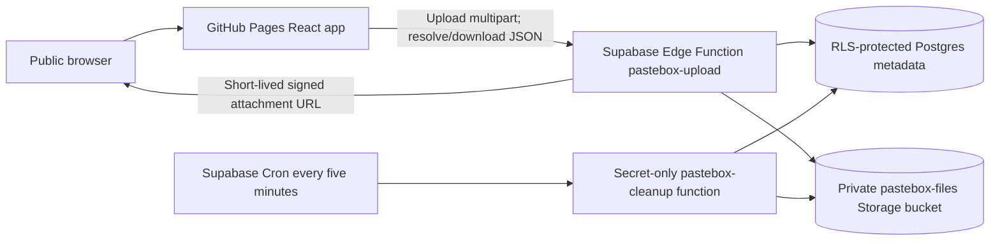

# Architecture

## Request path

GitHub Pages serves the static React app. Supabase Edge Functions are the only application API. The browser never queries Postgres or Storage directly. The publishable API key shipped in the app identifies requests to the public function; it is not a secret and receives no direct table/bucket privileges. `ctx.supabaseAdmin` is used only inside trusted functions.

## Upload lifecycle

1. The browser validates file size, then sends one multipart POST to `pastebox-upload`. Browser checks are convenience only.
2. The function checks the request length when available, parses one file plus its expected SHA-256 and optional first-download flag, validates the actual `File.size` (1–52,428,800 bytes), hashes the bytes, and atomically reserves per-IP hourly and global storage quota.
3. It creates a private pending metadata row before uploading. Storage object paths are random UUIDs and are not returned to the browser. Uploader name and purpose are no longer collected.
4. File bytes are uploaded to the private bucket as `application/octet-stream`, with overwrite disabled.
5. After Storage succeeds, the function generates independent 32-byte share and revoke tokens and stores only their SHA-256 hashes in Postgres. The record becomes active and expires exactly six hours after completed upload.
6. The raw share token is returned once to the browser and placed in a URL fragment (`#share=...`). The separate revoke token stays in the uploader's page state unless they copy it. Fragments are not included in HTTP requests or Referer headers. Do not add analytics or third-party scripts that could read tokens.

Pending rows expire after 30 minutes. The scheduled cleanup removes abandoned pending objects and rows.

## Share and download lifecycle

- There is no listing route or “view all files” query.
- The browser sends the share token in a JSON POST body to resolve metadata. The backend hashes it and compares against the stored hash.
- Metadata endpoints select only active records whose expiry is in the future. The database ID and Storage path are never returned.
- Download requests repeat token and expiry validation. A service-role SQL function increments the private download count atomically and permits only one successful claim when first-download deletion is enabled. Only then does the function return a signed Storage URL capped at 60 seconds. The browser downloads and SHA-256-verifies the bytes before saving an attachment.
- Revoke requests require the separate high-entropy revoke token and immediately mark the row unavailable. Revoked or downloaded objects are retried by scheduled cleanup. An already issued signed URL may remain usable for up to 60 seconds.
- `Referrer-Policy: no-referrer`, `Cache-Control: no-store`, and a URL fragment reduce incidental token exposure. A share link itself is a bearer credential and can still be copied, screenshotted, or exposed by the user.

## Data model

`supabase/migrations/20261020000000_create_secure_share_links.sql` defines:

### `public.pastebox_shares`

| Column | Meaning |
|---|---|
| `id` | Internal random UUID; never used as the share token or returned to visitors |
| `token_hash` | Unique SHA-256 hash of the 256-bit token; null only while a row is pending |
| `storage_path` | Internal random object path in the private bucket |
| `original_name` | Sanitized display/download filename |
| `file_size` | Verified size in bytes, from 1 to 52,428,800 |
| `uploader_name` | Legacy nullable field; no longer collected or returned |
| `purpose` | Legacy nullable field; no longer collected or returned |
| `revoke_token_hash` | Unique SHA-256 hash of private revoke capability; never returned after upload |
| `checksum_sha256` | SHA-256 of stored file bytes |
| `download_count` | Private count used for uploader-only stats |
| `delete_after_first_download` | Legacy compatibility column; new uploads do not enable one-download deletion |
| `status` | `pending` during upload; `active` after upload succeeds |
| `created_at` | Pending row creation time |
| `pending_expires_at` | Abandoned-upload cleanup time |
| `uploaded_at` | Server timestamp after Storage accepts the file |
| `expires_at` | Exactly six hours after `uploaded_at` |

### `public.pastebox_upload_limits`

Stores only an HMAC-SHA-256 of the forwarded client IP, one-hour window start, and count. The HMAC key exists only as `PASTEBOX_RATE_LIMIT_SECRET` in the Edge Function environment.

RLS is enabled, and `anon`/`authenticated`/`PUBLIC` have no table privileges or policies. The `consume_pastebox_upload_slot` function is executable only by `service_role`. The private Storage bucket has a 50 MiB size cap and no visitor policies. The migration drops the exact legacy Pastebox public policies and revokes direct privileges from the previous `public.files` table; it preserves old records and objects.

The follow-up migration `20261020100000_make_share_attribution_optional.sql` makes legacy attribution columns nullable and adds revoke capabilities, checksums, download counting, storage reservations, quota enforcement, and private owner usage RPCs. New uploads omit name and purpose; existing values are preserved but no longer included in share responses or shown in the interface.

## Expiry and physical cleanup

Link validation checks `expires_at` in trusted backend code for every resolution and download. At expiry, access is denied immediately.

Supabase Cron invokes `pastebox-cleanup` every five minutes. The function requires a Supabase secret key (`auth: 'secret'`), deletes expired, revoked, and first-download objects first, then their rows, and deletes abandoned pending uploads and stale quota reservations. Failed Storage removals leave rows for retry. Physical removal may lag the six-hour access cutoff by a schedule interval plus provider delays.

## Trust boundaries

- User fields, file names, MIME types, and file bytes are untrusted. Files are stored as opaque octet-stream downloads; no scanning or previewing occurs.
- The public upload/resolution endpoint can be called by non-browser clients. CORS is not authentication. Its publishable key is public; the application therefore relies on strict server-side validation, rate limits, RLS, and secret-only cleanup authorization.
- Share links grant access to anyone possessing the link until expiry. The token is random, not filename- or row-derived.
- No service key, database password, Vault secret, upload, or usable share token belongs in Git.
- Browser-side PWA caching is restricted to the static app shell and built assets. It excludes Edge Function responses, share payloads, signed Storage URLs, and file bytes.

