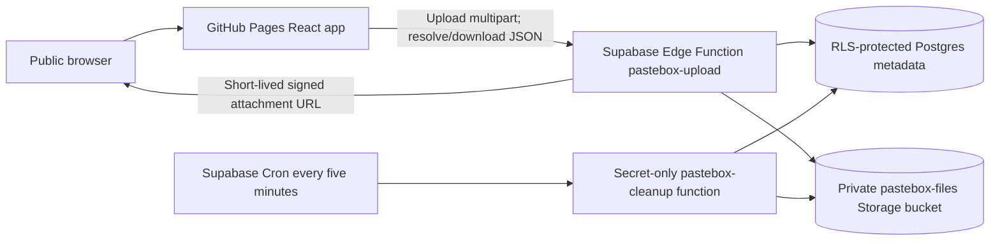

# Architecture

## Request path

GitHub Pages serves the static React app. Supabase Edge Functions are the only application API. The browser never queries Postgres or Storage directly. The publishable API key shipped in the app identifies requests to the public function; it is not a secret and receives no direct table/bucket privileges. `ctx.supabaseAdmin` is used only inside trusted functions.

## Upload lifecycle

1. The browser validates UX fields and file size, then sends one multipart POST to `pastebox-upload`. Browser checks are convenience only.
2. The function checks the request length when available, parses the multipart body, validates the actual `File.size` (1–52,428,800 bytes), validates name and purpose, and atomically consumes one per-IP rate-limit slot.
3. It creates a private pending metadata row before uploading. Storage object paths are random UUIDs and are not returned to the browser.
4. File bytes are uploaded to the private bucket as `application/octet-stream`, with overwrite disabled.
5. After Storage succeeds, the function generates 32 cryptographically random bytes, encodes them as a URL-safe token, and stores only `SHA-256(token)` in Postgres. The record becomes active and expires exactly six hours after completed upload.
6. The raw token is returned once to the browser and placed in a URL fragment (`#share=...`). Fragments are not included in HTTP requests or Referer headers. Do not add analytics or third-party scripts that could read the fragment.

Pending rows expire after 30 minutes. The scheduled cleanup removes abandoned pending objects and rows.

## Share and download lifecycle

- There is no listing route or “view all files” query.
- The browser sends the share token in a JSON POST body to resolve metadata. The backend hashes it and compares against the stored hash.
- Metadata endpoints select only active records whose expiry is in the future. The database ID and Storage path are never returned.
- Download requests repeat token and expiry validation. Only then does the function generate a signed Storage URL, capped at 60 seconds and never later than the file expiry. The URL forces attachment download.
- `Referrer-Policy: no-referrer`, `Cache-Control: no-store`, and a URL fragment reduce incidental token exposure. A share link itself is a bearer credential and can still be copied, screenshotted, or exposed by the user.

## Data model

`supabase/migrations/20261020000000_create_secure_share_links.sql` defines:

### `public.pastebox_shares`

| Column | Meaning |
|---|---|
| `id` | Internal random UUID; never used as the share token or returned to visitors |
| `token_hash` | Unique SHA-256 hash of the 256-bit token; null only while a row is pending |
| `storage_path` | Internal random object path in the private bucket |
| `original_name` | Sanitized display/download filename |
| `file_size` | Verified size in bytes, from 1 to 52,428,800 |
| `uploader_name` | Self-entered display name, 2–80 characters |
| `purpose` | Self-entered context, 10–240 characters |
| `status` | `pending` during upload; `active` after upload succeeds |
| `created_at` | Pending row creation time |
| `pending_expires_at` | Abandoned-upload cleanup time |
| `uploaded_at` | Server timestamp after Storage accepts the file |
| `expires_at` | Exactly six hours after `uploaded_at` |

### `public.pastebox_upload_limits`

Stores only an HMAC-SHA-256 of the forwarded client IP, one-hour window start, and count. The HMAC key exists only as `PASTEBOX_RATE_LIMIT_SECRET` in the Edge Function environment.

RLS is enabled, and `anon`/`authenticated`/`PUBLIC` have no table privileges or policies. The `consume_pastebox_upload_slot` function is executable only by `service_role`. The private Storage bucket has a 50 MiB size cap and no visitor policies. The migration drops the exact legacy Pastebox public policies and revokes direct privileges from the previous `public.files` table; it preserves old records and objects.

## Expiry and physical cleanup

Link validation checks `expires_at` in trusted backend code for every resolution and download. At expiry, access is denied immediately.

Supabase Cron invokes `pastebox-cleanup` every five minutes. The function requires a Supabase secret key (`auth: 'secret'`), deletes expired Storage objects first, then their rows, and deletes abandoned pending uploads. Failed Storage removals leave rows for retry. It also removes expired rate-limit rows. Physical removal may lag the six-hour access cutoff by up to one schedule interval plus provider delays.

## Trust boundaries

- User fields, file names, MIME types, and file bytes are untrusted. Files are stored as opaque octet-stream downloads; no scanning or previewing occurs.
- The public upload/resolution endpoint can be called by non-browser clients. CORS is not authentication. Its publishable key is public; the application therefore relies on strict server-side validation, rate limits, RLS, and secret-only cleanup authorization.
- Share links grant access to anyone possessing the link until expiry. The token is random, not filename- or row-derived.
- No service key, database password, Vault secret, upload, or usable share token belongs in Git.

